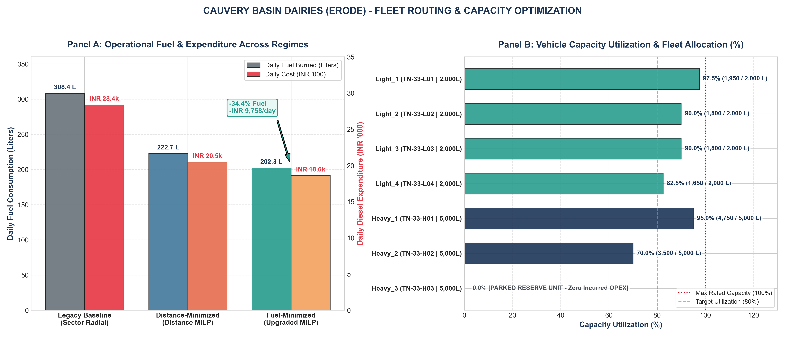

# 🥛 Cauvery Basin Dairies - Fleet Routing & Operations Research

An end-to-end Operations Research (OR) and geospatial engineering system solving the **Heterogeneous Capacitated Vehicle Routing Problem (H-CVRP)** for the **Cauvery Basin Dairies (Erode District Milk Union)**. 

Using **Mixed-Integer Linear Programming (MILP)**, this project optimizes raw milk procurement across 20 collection centers (12 primary and 8 rural nodes) feeding the central chilling and processing dairy plant at **Chithode**, Tamil Nadu.

---

## 📊 Key Business Impact & ROI

By transitioning from empirical sector-radial dispatching to true fuel-minimization MILP routing, the cooperative achieves substantial cost and operational efficiencies:

| Performance Metric | Legacy Baseline | Optimized MILP | Net Impact / Savings |
| :--- | :---: | :---: | :---: |
| **Single-Shift Fuel Burned** | 154.20 L | 101.18 L | **-53.02 L (-34.4%)** |
| **Daily Fuel Consumption (2 Shifts)** | 308.40 L | 202.36 L | **-106.04 L/day (-34.4%)** |
| **Daily Diesel OPEX (@ ₹92/L)** | ₹28,372.80 | ₹18,614.44 | **-₹9,758.36 / day** |
| **Projected Annual OPEX Savings** | ₹1.036 Crore | ₹67.94 Lakhs | **₹35.62 Lakhs / year** |
| **Fleet Milk Efficiency** | 100.19 L milk / L diesel | 152.70 L milk / L diesel | **+52.4% increase** |
| **Active Fleet Utilization** | 7 / 7 Vehicles | 6 / 7 Vehicles | **1 Parked Reserve Heavy Tanker** |

> 💡 **Strategic Reserve Benefit**: Tanker `Heavy_3` (`TN-33-H03`, 5,000L capacity) is uncommitted (0.0% utilization), remaining stationed at the Chithode depot as an emergency contingency reserve unit for breakdown backup, seasonal flush-period milk surges, or inter-dairy bulk transfer without expanding capital expenditure.

---

## 📈 Visual Dashboard



*Figure: Executive KPI Dashboard showing daily fuel & cost reductions (Panel A) and individual vehicle capacity utilization (Panel B).*

---

## 🧮 Mathematical Formulation Highlights

The problem is formulated as a Mixed-Integer Linear Program (MILP) solved using the COIN-OR CBC branch-and-cut solver:

1. **True Fuel Minimization Objective**:
   $$\min Z = \sum_{k \in K} \sum_{i \in V} \sum_{j \neq i} \left( \frac{d_{ij}}{m_k} \right) x_{ijk}$$
   Directly accounts for vehicle fuel economies (4.0 km/L for 5,000L Heavy Tankers vs. 8.0 km/L for 2,000L Light Tankers), eliminating the distortion of pure distance minimization and allocating light trucks to long, multi-stop rural runs.

2. **Shift Capacity Balancing**:
   Resolves the baseline daily volume deficit (30,900 L demand vs. 23,000 L total fleet capacity) by modeling morning/evening collection shifts (15,450 L/shift), providing a 32.8% operational headroom buffer.

3. **Infrastructure Walls (Zero Rural Incursions)**:
   $$x_{ijk} = 0 \quad \text{and} \quad x_{jik} = 0, \quad \forall j \in V_{\text{rural}}, \; \forall i \in V, \; \forall k \in K_{\text{heavy}}$$
   Hard constraints preventing heavy multi-axle tankers from entering narrow rural roads and weight-restricted bridges, routing only Light Commercial Vehicles (LCVs) to rural nodes.

4. **Desrochers-Laporte MTZ Subtour Elimination**:
   $$u_{ik} - u_{jk} + C_k x_{ijk} \le C_k - q_j, \quad \forall i \neq j \in V_c, \; \forall k \in K$$
   Tightened continuous load variables ($q_i \le u_{ik} \le C_k$) eliminating detached cycles while enforcing cumulative payload tracking.

5. **Load-Symmetry Breaking**:
   Enforces descending load ordering within identical vehicle classes ($\text{Load}(\text{H1}) \ge \text{Load}(\text{H2}) \ge \text{Load}(\text{H3})$), collapsing branch-and-bound exploration permutations and accelerating solver convergence to under 90 seconds.

---

## 🛠️ Tech Stack

- **Optimization**: Python 3.11, [PuLP](https://coin-or.github.io/pulp/) (COIN-OR CBC Branch-and-Cut Solver)
- **Data Engineering**: [Pandas](https://pandas.pydata.org/), NumPy
- **Geospatial & Mapping**: [Folium](https://python-visualization.github.io/folium/), [OSRM API](http://project-osrm.org/) (Open Source Routing Machine road snapping)
- **Visualization**: [Matplotlib](https://matplotlib.org/) (Executive KPI dual-panel dashboard)
- **Technical Reporting**: LaTeX (`booktabs`, `amsmath`, `geometry`, `graphicx`)

---

## 📁 Repository Structure

| File | Description |
| :--- | :--- |
| [`erode_collection_nodes.csv`](erode_collection_nodes.csv) | 21 Nodes: Chithode Central Depot (Node 0) + 12 Primary and 8 Rural collection centers with coordinates and demands. |
| [`distance_matrix.csv`](distance_matrix.csv) | Asymmetric 21x21 road network distance matrix (km). |
| [`time_matrix.csv`](time_matrix.csv) | Asymmetric 21x21 road transit duration matrix (minutes). |
| [`data_ingestion.py`](data_ingestion.py) | Ingestion pipeline: shift demand normalization (split shifts) and fast nested dictionary query structures. |
| [`solve_fleet.py`](solve_fleet.py) | Full MILP fuel-minimization optimization model with MTZ constraints, infrastructure walls, and symmetry breaking. |
| [`optimized_fleet_routes.csv`](optimized_fleet_routes.csv) | Solved optimal vehicle route dispatches, stop sequences, distances, loads, utilization, and diesel costs. |
| [`visualize_fleet.py`](visualize_fleet.py) | Geospatial visualization generator querying OSRM for road geometry and Matplotlib for the dual-panel executive dashboard. |
| [`erode_fleet_map.html`](erode_fleet_map.html) | Interactive Leaflet/Folium web map with over 10,500 road-snapped coordinates, custom registration labels, and multi-base layers (Esri, Google Streets). |
| [`fleet_roi_dashboard.png`](fleet_roi_dashboard.png) | High-resolution 300-DPI visual executive dashboard comparing baseline vs. optimized regimes and vehicle utilization. |
| [`generate_latex_report.py`](generate_latex_report.py) | Automated script parsing solved metrics and compiling the formal academic/technical report in LaTeX. |
| [`regional_fleet_optimization.tex`](regional_fleet_optimization.tex) | Complete, compile-ready LaTeX technical document detailing the mathematical formulation, proofs, and financial ROI. |

---

## 🚀 Execution Workflow

### 1. Ingest Data & Verify Shift Capacities
```bash
python data_ingestion.py
```

### 2. Execute Mixed-Integer Linear Program
```bash
python solve_fleet.py
```

### 3. Generate Geospatial Map & ROI Dashboard
```bash
python visualize_fleet.py
```

### 4. Build LaTeX Technical Report
```bash
python generate_latex_report.py
```

---

## 🗺️ Geospatial Route Highlights

- **OSRM Road Network Snapping**: Replaces crude straight-line Euclidean vectors with 10,571 actual road waypoints across Erode district.
- **Strict Vehicle Allocation**:
  - `Heavy_1` (TN-33-H01): Southern high-density arterial corridor (Perundurai $\to$ Chennimalai $\to$ Kodumudi $\to$ Modakurichi $\to$ Uthukuli) at **95.0% utilization**.
  - `Heavy_2` (TN-33-H02): Northern highway spine (Anthiyur $\to$ Appakudal $\to$ Kavundappadi $\to$ Thingalur) at **70.0% utilization**.
  - `Light_1` - `Light_4` (TN-33-L01 to L04): Rural milk collection centers, completely isolating heavy tankers from narrow village infrastructure.
  - `Heavy_3` (TN-33-H03): 0.0 km, 0 L load — **Standby reserve unit**.

---

## 👨‍💻 Author & Attribution

- **Arun Ramanathan U** — PSG College of Technology
- Operations Research & Supply Chain Optimization applied to Regional Dairy Logistics.
